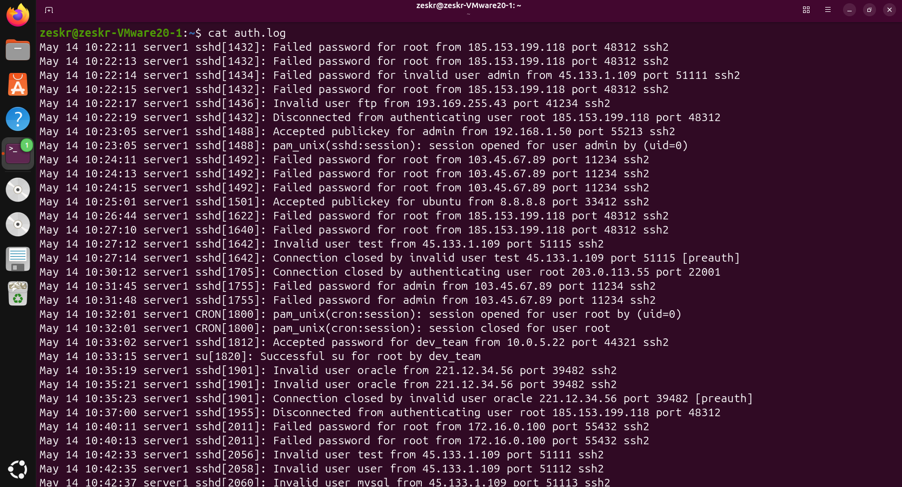
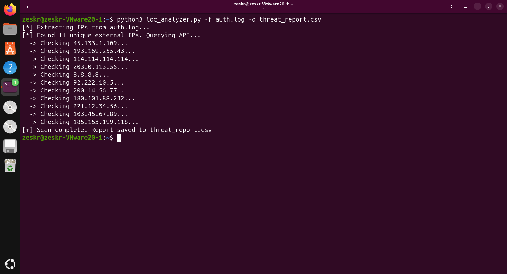
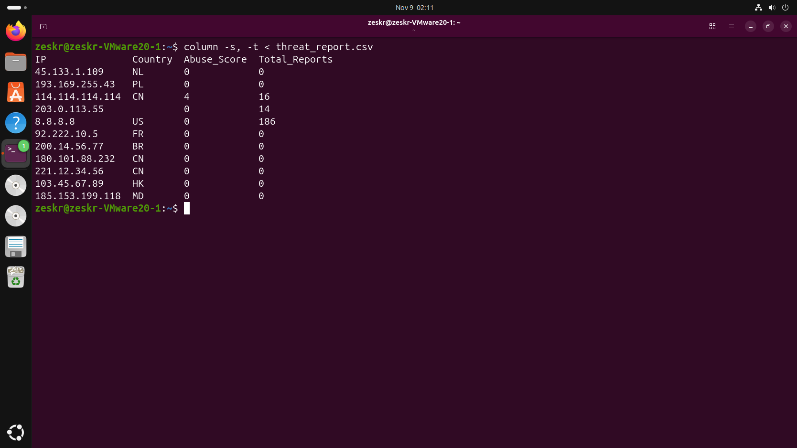

# 🔍 Automated Threat Intelligence IoC Analyzer

## Overview
A lightweight, automated Security Operations Center (SOC) utility designed to parse unstructured Linux authentication logs, extract potential Indicators of Compromise (IoCs), and enrich the data using external Threat Intelligence APIs. 

This tool shifts manual log review into an automated pipeline, allowing infrastructure defenders to rapidly identify malicious IP addresses conducting SSH brute-force attacks or unauthorized access attempts.

## Technical Skills Applied
* **Unstructured Data Parsing:** Utilizing Python Regular Expressions (Regex) to extract unique IPv4 addresses from noisy `/var/log/auth.log` files.
* **API Integration:** Automating REST API queries to the AbuseIPDB endpoint and handling nested JSON responses.
* **Defensive Engineering:** Implementing rate-limiting considerations, error handling for network timeouts, and bypassing private/internal IP subnets to optimize API quotas.
* **Data Structuring:** Converting raw JSON threat intelligence into structured, human-readable formats (Terminal tables / CSV) for incident response reporting.

## Installation & Usage

**Prerequisites:** Python 3.x, `requests` library, and a valid AbuseIPDB API key.

```bash
# Clone the repository
git clone [https://github.com/Zeskr/Automated-IoC-Analyzer.git](https://github.com/Zeskr/Automated-IoC-Analyzer.git)
cd Automated-IoC-Analyzer

# Execute the script against a target log file
python3 ioc_analyzer.py -f auth.log -o threat_report.csv
```

---

## Technical Execution & Workflow

### Phase 1: Ingestion (Raw System Logs)
The script targets raw system logs. In this execution, it is fed a standard Linux `auth.log` containing simulated brute-force attempts and invalid user logins.



### Phase 2: Processing & Enrichment
The script parses the unstructured text, deduplicates the extracted IP addresses to save API calls, and queries the AbuseIPDB threat intelligence database to retrieve the abuse confidence score and country of origin for each node.



### Phase 3: Structured Output
The unstructured log data and JSON API responses are compiled into a clean, actionable CSV report. This allows security engineers to immediately identify high-risk nodes (e.g., the Chinese IP with a history of abuse reports) and implement firewall drops.


